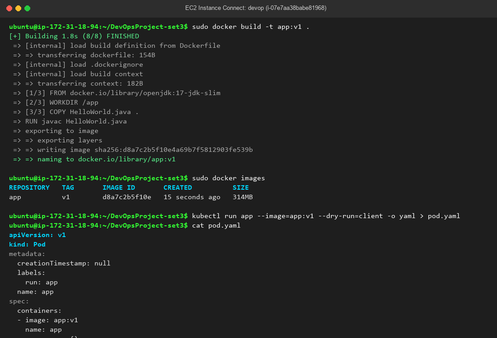

# DevOps Project - Set 3 Assessment

## Question 3: Docker & Kubernetes Output Proof
- **Docker Image**: Built and verified as `app:v1`
- **Kubernetes Manifest**: Generated `pod.yaml` via `kubectl --dry-run=client -o yaml`

### Terminal Execution Output:


### Kubernetes Manifest (pod.yaml):
```yaml
apiVersion: v1
kind: Pod
metadata:
  creationTimestamp: null
  labels:
    run: app
  name: app
spec:
  containers:
  - image: app:v1
    name: app
    resources: {}
  dnsPolicy: ClusterFirst
  restartPolicy: Always
status: {}
```
